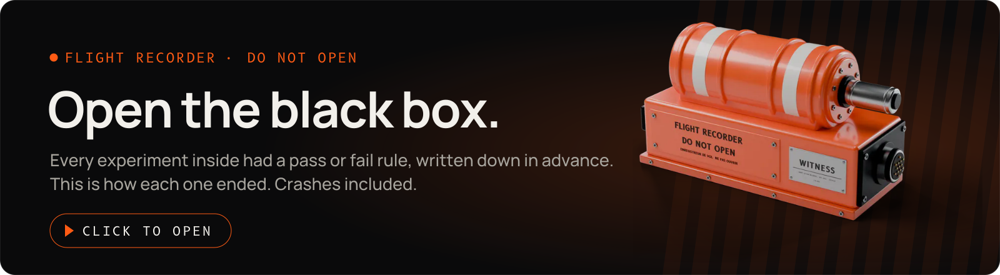

<a href="https://gautamkhosla.com"><picture><source media="(prefers-color-scheme: dark) and (max-width: 1060px)" srcset="assets/hero-dark-n.svg"><source media="(max-width: 1060px)" srcset="assets/hero-light-n.svg"><source media="(prefers-color-scheme: dark)" srcset="assets/hero-dark.svg"></picture></a>

**Gautam Khosla** · Ottawa, Canada · Computer Engineering at uOttawa

I build software you can check instead of trust: approvals you sign with a passkey, records anyone can verify offline,
and pass or fail rules written down before the results. When something fails, the failure gets published too.

[gautamkhosla.com](https://gautamkhosla.com) · [YouTube](https://www.youtube.com/@GautamKhoslaOfficial) · [LinkedIn](https://www.linkedin.com/in/gautam-khosla/) · [Gautam Talks](https://gautamtalks.com) · [developwith.gt@gmail.com](mailto:developwith.gt@gmail.com)

 

<a href="#products"><picture><source media="(prefers-color-scheme: dark) and (max-width: 1060px)" srcset="assets/head-products-dark-n.svg"><source media="(max-width: 1060px)" srcset="assets/head-products-light-n.svg"><source media="(prefers-color-scheme: dark)" srcset="assets/head-products-dark.svg"></picture></a>

<a href="https://counterseal.gautamkhosla.com"><picture><source media="(max-width: 1060px)" srcset="assets/card-counterseal-n.svg"></picture></a>

**Counterseal** · Every irreversible action gets a second seal. 
Your AI agent gets a scoped token instead of your real API key. A call it cannot take back (a delete, a force push, a refund) is held until you approve that exact request, once, with a passkey, and with receipts on, every decision on a write becomes an entry in a public log anyone can check. The irreversible map covers 10 APIs, management APIs only: SQL sent straight over a database connection string never passes through Counterseal. Free public beta. 
[Website](https://counterseal.gautamkhosla.com) · [Source](https://github.com/GautamTalksDev/counterseal) · [npm](https://www.npmjs.com/package/counterseal) · `npx counterseal login`

<a href="https://craclock.gautamkhosla.com"><picture><source media="(max-width: 1060px)" srcset="assets/card-cra-clock-n.svg"></picture></a>

**CRA Clock** · 24 hours starts the moment you know. 
The EU Cyber Resilience Act reporting clock, as a GitHub Action. It reads 12 lockfile formats, writes a CycloneDX 1.6 SBOM and checks every component against OSV, CISA KEV and FIRST EPSS. When something you ship is actively exploited, it opens an issue with the Article 14 deadlines and pre-filled early warning and notification drafts. Free and open source. 
[Website](https://craclock.gautamkhosla.com) · [GitHub Marketplace](https://github.com/marketplace/actions/cra-clock) · [Source](https://github.com/GautamTalksDev/cra-clock) · `uses: GautamTalksDev/cra-clock@v1`

<a href="https://holdout.gautamkhosla.com"><picture><source media="(max-width: 1060px)" srcset="assets/card-holdout-n.svg"></picture></a>

**Holdout** · Phones down. Together. 
A campfire you keep alive with your friends. Everyone goes dark at the same time; if anyone breaks, everyone sees. No account, no ads, no tracking: your phone is your key. Android, in beta. 
[Website](https://holdout.gautamkhosla.com) · [Join the Android beta](https://holdout.gautamkhosla.com/beta/)

 

<a href="#projects"><picture><source media="(prefers-color-scheme: dark) and (max-width: 1060px)" srcset="assets/head-projects-dark-n.svg"><source media="(max-width: 1060px)" srcset="assets/head-projects-light-n.svg"><source media="(prefers-color-scheme: dark)" srcset="assets/head-projects-dark.svg"></picture></a>
<a href="https://mcp-pin.gautamkhosla.com"><picture><source media="(prefers-color-scheme: dark) and (max-width: 1060px)" srcset="assets/row-mcp-pin-dark-n.svg"><source media="(max-width: 1060px)" srcset="assets/row-mcp-pin-light-n.svg"><source media="(prefers-color-scheme: dark)" srcset="assets/row-mcp-pin-dark.svg"></picture></a>
<a href="https://dodge.gautamkhosla.com"><picture><source media="(prefers-color-scheme: dark) and (max-width: 1060px)" srcset="assets/row-dodge-dark-n.svg"><source media="(max-width: 1060px)" srcset="assets/row-dodge-light-n.svg"><source media="(prefers-color-scheme: dark)" srcset="assets/row-dodge-dark.svg"></picture></a>
<a href="#markd"><picture><source media="(prefers-color-scheme: dark) and (max-width: 1060px)" srcset="assets/row-markd-dark-n.svg"><source media="(max-width: 1060px)" srcset="assets/row-markd-light-n.svg"><source media="(prefers-color-scheme: dark)" srcset="assets/row-markd-dark.svg"></picture></a>
<a href="https://counterseal.gautamkhosla.com"><picture><source media="(prefers-color-scheme: dark) and (max-width: 1060px)" srcset="assets/row-merged-dark-n.svg"><source media="(max-width: 1060px)" srcset="assets/row-merged-light-n.svg"><source media="(prefers-color-scheme: dark)" srcset="assets/row-merged-dark.svg"></picture></a>

- **[mcp-pin](https://mcp-pin.gautamkhosla.com)** pins the MCP tool definitions you approved and blocks the session when they change, and keeps a public log of the changes it sees. Zero runtime dependencies, MIT. [Source](https://github.com/GautamTalksDev/mcp-pin) · [npm](https://www.npmjs.com/package/mcp-pin) · [Spot the rug pull](https://mcp-pin.gautamkhosla.com/spot/) (a 60 second game) · [The 7 minute video](https://www.youtube.com/watch?v=tGtbDNr9qvE)
- **[DODGE](https://dodge.gautamkhosla.com)** asks who makes Starlink dodge: a daily screen of predicted close approaches between Starlink and everything else in low Earth orbit, each one attributed to an owner, signed and verifiable. SGP4 on public CelesTrak data; screening grade, not collision probability. [Source](https://github.com/GautamTalksDev/dodge)
- **MARKD** writes machine-readable "this is AI-generated" marks into images and text, with an Ed25519-signed manifest bound to the content hash, for EU AI Act Article 50(2). **Paused:** it works, but it is not under active development. It has no C2PA support and no robust watermark, and the EU Code of Practice expects those layers together with signed metadata.
- **LEASH, WITNESS and SIGIL** became one product in October 2026: LEASH's passkey-held calls, WITNESS's public receipt log and SIGIL's signed agent requests now live in [Counterseal](https://counterseal.gautamkhosla.com). [LEASH source](https://github.com/GautamTalksDev/leash)

 

<a name="black-box"><picture><source media="(max-width: 1060px)" srcset="assets/blackbox-n.svg"></picture></a>

 

Each of these experiments was judged by a pass or fail rule written down before the results. The rules stay in the READMEs, so they cannot be quietly renegotiated later.

| Flight | The rule, written first | How it ended |
|---|---|---|
| [label-to-lab](https://github.com/GautamTalksDev/label-to-lab) | Predict a packaged food's measured acrylamide from its ingredient list: at least a 20% RMSE reduction over the category-median baseline | **FAIL.** 9.8%. A clear negative, published with the data |
| [assay-gpu](https://github.com/GautamTalksDev/assay-gpu) | Catch at least 90% of exponent-bit flips in bfloat16 GEMM | **FAIL.** 76%. The detector was not retuned and the bar was not moved. [Paper](https://doi.org/10.5281/zenodo.22054179) |
| [Lading](https://github.com/GautamTalksDev/Lading) | Prove vulnerabilities absent from shipped binaries | **FAIL.** Both pre-registered tests went against it, so it stopped by its own rule. Paper, corpus and audit trail [published](https://doi.org/10.5281/zenodo.22093232) |
| [jevbench](https://github.com/GautamTalksDev/jevbench) | A [preregistered](https://doi.org/10.5281/zenodo.22971413) test of whether a model's confidence tracks human disagreement | **Done.** Close to calibrated where people agree, overconfident where they split. [Paper](https://doi.org/10.5281/zenodo.22971491) |
| [PLIMSOLL](https://github.com/GautamTalksDev/plimsoll) | A public log that seals an evaluation's metric and threshold before the run | **No field data yet.** Its tests cannot be scored at N=0, and the README says so |

<b>The hangar:</b> 19 more public builds, from hackathon projects to research tools

 

| Build | What it is |
|---|---|
| [Refledger](https://github.com/GautamTalksDev/refledger) | Checks whether a workflow runs the code you think it does, pins every action, and backs it with a public signed ledger |
| [Plumbline](https://github.com/GautamTalksDev/Plumbline) | A public, append-only log of MCP tool definitions that catches changes after publication |
| [Cairn](https://github.com/GautamTalksDev/Cairn) | Integrity monitoring for GPS-denied positioning: flags when a robot's pose estimate has silently gone wrong |
| [Vernier](https://github.com/GautamTalksDev/Vernier) | A deterministic diff for agent behaviour: record a run, re-drive it after a change, get a rule-based verdict |
| [Keyring](https://github.com/GautamTalksDev/keyring) | An access governance agent: finds the grants people and agents still hold, waits for a human, writes a verifiable audit trail |
| [Bedrock](https://github.com/GautamTalksDev/Bedrock) | Self-healing web scrapers; every automatic repair is tested against golden fixtures before it ships |
| [Ephemera](https://github.com/GautamTalksDev/Ephemera) | Preview environments without Kubernetes: open a PR, get a full stack with a live URL; close it, it is gone |
| [mayfly-guest](https://github.com/GautamTalksDev/mayfly-guest) | A snapshot-optimised Linux guest for Firecracker microVMs, with open measurement harnesses |
| [Porchlight](https://github.com/GautamTalksDev/porchlight) | An offline-first emergency network for neighbourhoods, for when the grid goes dark |
| [takehome](https://github.com/GautamTalksDev/takehome) | Canadian payroll deduction calculation, versioned by effective date, that shows its work |
| [groundhog](https://github.com/GautamTalksDev/groundhog) | Reads local coding-agent history and ranks the chores you keep paying an agent to redo. Local only |
| [AEGIS](https://github.com/GautamTalksDev/AEGIS) | Edge AI worksite safety on QNX 8.0 and a Raspberry Pi 5 in C++20; the safety loop never touches the network |
| [HyperShift](https://github.com/GautamTalksDev/HyperShift) | Describe infrastructure in plain English; five agents plan, build, scan, deploy and monitor it |
| [MetaShift](https://github.com/GautamTalksDev/MetaShift) | Multi-tenant observability that detects and auto-resolves conflicts across services, with incident replay |
| [Work-Shift](https://github.com/GautamTalksDev/Work-Shift) | An approval inbox for Slack: review AI-drafted messages before they send |
| [AeroGuard](https://github.com/GautamTalksDev/aeroguard-tech) | SOC incident triage built at ConUHacks, with similar-incident search and live updates |
| [gautamtalks.com](https://github.com/GautamTalksDev/gautamtalks-site) | The Gautam Talks creator site: hand written, zero frameworks, with a 3D room hidden inside |
| [gautamkhosla.com](https://github.com/GautamTalksDev/gautamtalksdev.github.io) | A personal site built as an engineering spec sheet; no framework, works offline |
| [DSA assignments](https://github.com/GautamTalksDev/DSA-Programming-Assignments) | Data structures and algorithms in Java, from university programming assignments |

 

Every image on this page is a file in this repository: SVG with its text drawn as paths, and no fonts, scripts, trackers or third-party widgets. 
The boards flip once when the page loads (with reduced motion they arrive finished). DODGE's numbers come from its public daily data, dated on the row.

