<!-- Generated by flightlog/build.py from profile.toml. Edit profile.toml, not this file. -->

<a href="https://gautamkhosla.com"><picture><source media="(prefers-color-scheme: dark) and (max-width: 767px)" srcset="assets/hero-dark-n.svg?v=2026-11-08"><source media="(max-width: 767px)" srcset="assets/hero-light-n.svg?v=2026-11-08"><source media="(prefers-color-scheme: dark)" srcset="assets/hero-dark.svg?v=2026-11-08"></picture></a>

 

<a href="https://gautamkhosla.com"><picture><source media="(prefers-color-scheme: dark)" srcset="assets/link-0-dark.svg">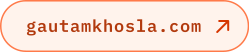</picture></a> <a href="https://www.youtube.com/@GautamKhoslaOfficial"><picture><source media="(prefers-color-scheme: dark)" srcset="assets/link-1-dark.svg">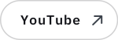</picture></a> <a href="https://www.linkedin.com/in/gautam-khosla/"><picture><source media="(prefers-color-scheme: dark)" srcset="assets/link-2-dark.svg">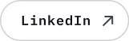</picture></a> <a href="https://gautamtalks.com"><picture><source media="(prefers-color-scheme: dark)" srcset="assets/link-3-dark.svg">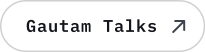</picture></a> <a href="mailto:developwith.gt@gmail.com"><picture><source media="(prefers-color-scheme: dark)" srcset="assets/link-4-dark.svg"></picture></a>

 

<a name="missions"><picture><source media="(prefers-color-scheme: dark) and (max-width: 767px)" srcset="assets/head-missions-dark-n.svg"><source media="(max-width: 767px)" srcset="assets/head-missions-light-n.svg"><source media="(prefers-color-scheme: dark)" srcset="assets/head-missions-dark.svg"></picture></a>

<a href="https://counterseal.gautamkhosla.com"><picture><source media="(prefers-color-scheme: dark) and (max-width: 767px)" srcset="assets/mission-1-dark-n.svg"><source media="(max-width: 767px)" srcset="assets/mission-1-light-n.svg"><source media="(prefers-color-scheme: dark)" srcset="assets/mission-1-dark.svg"></picture></a>

<a href="https://craclock.gautamkhosla.com"><picture><source media="(prefers-color-scheme: dark) and (max-width: 767px)" srcset="assets/mission-2-dark-n.svg"><source media="(max-width: 767px)" srcset="assets/mission-2-light-n.svg"><source media="(prefers-color-scheme: dark)" srcset="assets/mission-2-dark.svg"></picture></a>

<a href="https://holdout.gautamkhosla.com"><picture><source media="(prefers-color-scheme: dark) and (max-width: 767px)" srcset="assets/mission-3-dark-n.svg"><source media="(max-width: 767px)" srcset="assets/mission-3-light-n.svg"><source media="(prefers-color-scheme: dark)" srcset="assets/mission-3-dark.svg"></picture></a>

 

<a name="orbit"><picture><source media="(prefers-color-scheme: dark) and (max-width: 767px)" srcset="assets/head-orbit-dark-n.svg"><source media="(max-width: 767px)" srcset="assets/head-orbit-light-n.svg"><source media="(prefers-color-scheme: dark)" srcset="assets/head-orbit-dark.svg"></picture></a>

<a href="https://mcp-pin.gautamkhosla.com"><picture><source media="(prefers-color-scheme: dark) and (max-width: 767px)" srcset="assets/orbit-1-dark-n.svg"><source media="(max-width: 767px)" srcset="assets/orbit-1-light-n.svg"><source media="(prefers-color-scheme: dark)" srcset="assets/orbit-1-dark.svg">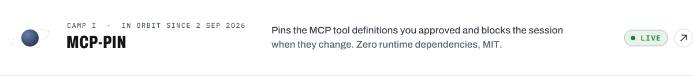</picture></a>

<a href="https://dodge.gautamkhosla.com"><picture><source media="(prefers-color-scheme: dark) and (max-width: 767px)" srcset="assets/orbit-2-dark-n.svg?v=2026-11-08"><source media="(max-width: 767px)" srcset="assets/orbit-2-light-n.svg?v=2026-11-08"><source media="(prefers-color-scheme: dark)" srcset="assets/orbit-2-dark.svg?v=2026-11-08"></picture></a>

<a href="https://counterseal.gautamkhosla.com"><picture><source media="(prefers-color-scheme: dark) and (max-width: 767px)" srcset="assets/orbit-3-dark-n.svg"><source media="(max-width: 767px)" srcset="assets/orbit-3-light-n.svg"><source media="(prefers-color-scheme: dark)" srcset="assets/orbit-3-dark.svg">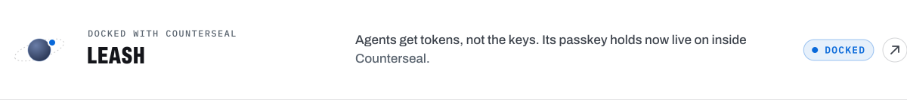</picture></a>

 

<a name="expeditions"><picture><source media="(prefers-color-scheme: dark) and (max-width: 767px)" srcset="assets/head-expeditions-dark-n.svg"><source media="(max-width: 767px)" srcset="assets/head-expeditions-light-n.svg"><source media="(prefers-color-scheme: dark)" srcset="assets/head-expeditions-dark.svg"></picture></a>

<a href="https://github.com/GautamTalksDev/label-to-lab"><picture><source media="(prefers-color-scheme: dark) and (max-width: 767px)" srcset="assets/expedition-1-dark-n.svg"><source media="(max-width: 767px)" srcset="assets/expedition-1-light-n.svg"><source media="(prefers-color-scheme: dark)" srcset="assets/expedition-1-dark.svg"></picture></a> <a href="https://github.com/GautamTalksDev/assay-gpu"><picture><source media="(prefers-color-scheme: dark) and (max-width: 767px)" srcset="assets/expedition-2-dark-n.svg"><source media="(max-width: 767px)" srcset="assets/expedition-2-light-n.svg"><source media="(prefers-color-scheme: dark)" srcset="assets/expedition-2-dark.svg"></picture></a> <a href="https://github.com/GautamTalksDev/Lading"><picture><source media="(prefers-color-scheme: dark) and (max-width: 767px)" srcset="assets/expedition-3-dark-n.svg"><source media="(max-width: 767px)" srcset="assets/expedition-3-light-n.svg"><source media="(prefers-color-scheme: dark)" srcset="assets/expedition-3-dark.svg"></picture></a> <a href="https://github.com/GautamTalksDev/jevbench"><picture><source media="(prefers-color-scheme: dark) and (max-width: 767px)" srcset="assets/expedition-4-dark-n.svg"><source media="(max-width: 767px)" srcset="assets/expedition-4-light-n.svg"><source media="(prefers-color-scheme: dark)" srcset="assets/expedition-4-dark.svg"></picture></a> <a href="https://github.com/GautamTalksDev/plimsoll"><picture><source media="(prefers-color-scheme: dark) and (max-width: 767px)" srcset="assets/expedition-5-dark-n.svg"><source media="(max-width: 767px)" srcset="assets/expedition-5-light-n.svg"><source media="(prefers-color-scheme: dark)" srcset="assets/expedition-5-dark.svg"></picture></a>

Papers and preregistrations: <a href="https://doi.org/10.5281/zenodo.22054179">assay-gpu paper</a> · <a href="https://doi.org/10.5281/zenodo.22093232">Lading paper</a> · <a href="https://doi.org/10.5281/zenodo.22971413">jevbench preregistration</a> · <a href="https://doi.org/10.5281/zenodo.22971491">jevbench paper</a>

 

<a name="hangar"><picture><source media="(prefers-color-scheme: dark) and (max-width: 767px)" srcset="assets/head-hangar-dark-n.svg"><source media="(max-width: 767px)" srcset="assets/head-hangar-light-n.svg"><source media="(prefers-color-scheme: dark)" srcset="assets/head-hangar-dark.svg"></picture></a>

<a href="https://github.com/GautamTalksDev/refledger"><picture><source media="(prefers-color-scheme: dark) and (max-width: 767px)" srcset="assets/hangar-1-dark-n.svg"><source media="(max-width: 767px)" srcset="assets/hangar-1-light-n.svg"><source media="(prefers-color-scheme: dark)" srcset="assets/hangar-1-dark.svg">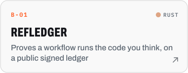</picture></a> <a href="https://github.com/GautamTalksDev/Plumbline"><picture><source media="(prefers-color-scheme: dark) and (max-width: 767px)" srcset="assets/hangar-2-dark-n.svg"><source media="(max-width: 767px)" srcset="assets/hangar-2-light-n.svg"><source media="(prefers-color-scheme: dark)" srcset="assets/hangar-2-dark.svg">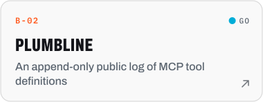</picture></a> <a href="https://github.com/GautamTalksDev/Cairn"><picture><source media="(prefers-color-scheme: dark) and (max-width: 767px)" srcset="assets/hangar-3-dark-n.svg"><source media="(max-width: 767px)" srcset="assets/hangar-3-light-n.svg"><source media="(prefers-color-scheme: dark)" srcset="assets/hangar-3-dark.svg">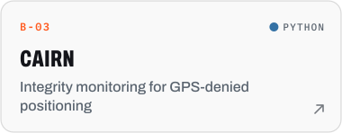</picture></a> <a href="https://github.com/GautamTalksDev/Vernier"><picture><source media="(prefers-color-scheme: dark) and (max-width: 767px)" srcset="assets/hangar-4-dark-n.svg"><source media="(max-width: 767px)" srcset="assets/hangar-4-light-n.svg"><source media="(prefers-color-scheme: dark)" srcset="assets/hangar-4-dark.svg">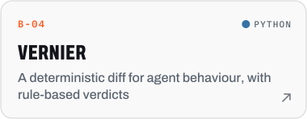</picture></a> <a href="https://github.com/GautamTalksDev/keyring"><picture><source media="(prefers-color-scheme: dark) and (max-width: 767px)" srcset="assets/hangar-5-dark-n.svg"><source media="(max-width: 767px)" srcset="assets/hangar-5-light-n.svg"><source media="(prefers-color-scheme: dark)" srcset="assets/hangar-5-dark.svg">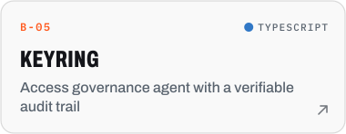</picture></a> <a href="https://github.com/GautamTalksDev/Bedrock"><picture><source media="(prefers-color-scheme: dark) and (max-width: 767px)" srcset="assets/hangar-6-dark-n.svg"><source media="(max-width: 767px)" srcset="assets/hangar-6-light-n.svg"><source media="(prefers-color-scheme: dark)" srcset="assets/hangar-6-dark.svg">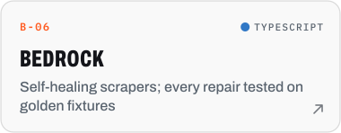</picture></a> <a href="https://github.com/GautamTalksDev/Ephemera"><picture><source media="(prefers-color-scheme: dark) and (max-width: 767px)" srcset="assets/hangar-7-dark-n.svg"><source media="(max-width: 767px)" srcset="assets/hangar-7-light-n.svg"><source media="(prefers-color-scheme: dark)" srcset="assets/hangar-7-dark.svg"></picture></a> <a href="https://github.com/GautamTalksDev/mayfly-guest"><picture><source media="(prefers-color-scheme: dark) and (max-width: 767px)" srcset="assets/hangar-8-dark-n.svg"><source media="(max-width: 767px)" srcset="assets/hangar-8-light-n.svg"><source media="(prefers-color-scheme: dark)" srcset="assets/hangar-8-dark.svg">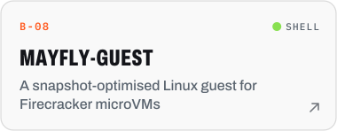</picture></a> <a href="https://github.com/GautamTalksDev/porchlight"><picture><source media="(prefers-color-scheme: dark) and (max-width: 767px)" srcset="assets/hangar-9-dark-n.svg"><source media="(max-width: 767px)" srcset="assets/hangar-9-light-n.svg"><source media="(prefers-color-scheme: dark)" srcset="assets/hangar-9-dark.svg">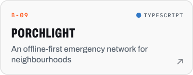</picture></a> <a href="https://github.com/GautamTalksDev/takehome"><picture><source media="(prefers-color-scheme: dark) and (max-width: 767px)" srcset="assets/hangar-10-dark-n.svg"><source media="(max-width: 767px)" srcset="assets/hangar-10-light-n.svg"><source media="(prefers-color-scheme: dark)" srcset="assets/hangar-10-dark.svg">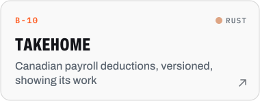</picture></a> <a href="https://github.com/GautamTalksDev/groundhog"><picture><source media="(prefers-color-scheme: dark) and (max-width: 767px)" srcset="assets/hangar-11-dark-n.svg"><source media="(max-width: 767px)" srcset="assets/hangar-11-light-n.svg"><source media="(prefers-color-scheme: dark)" srcset="assets/hangar-11-dark.svg">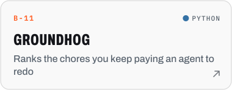</picture></a> <a href="https://github.com/GautamTalksDev/AEGIS"><picture><source media="(prefers-color-scheme: dark) and (max-width: 767px)" srcset="assets/hangar-12-dark-n.svg"><source media="(max-width: 767px)" srcset="assets/hangar-12-light-n.svg"><source media="(prefers-color-scheme: dark)" srcset="assets/hangar-12-dark.svg">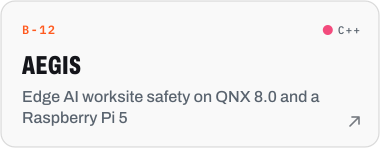</picture></a> <a href="https://github.com/GautamTalksDev/HyperShift"><picture><source media="(prefers-color-scheme: dark) and (max-width: 767px)" srcset="assets/hangar-13-dark-n.svg"><source media="(max-width: 767px)" srcset="assets/hangar-13-light-n.svg"><source media="(prefers-color-scheme: dark)" srcset="assets/hangar-13-dark.svg">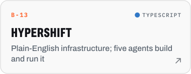</picture></a> <a href="https://github.com/GautamTalksDev/MetaShift"><picture><source media="(prefers-color-scheme: dark) and (max-width: 767px)" srcset="assets/hangar-14-dark-n.svg"><source media="(max-width: 767px)" srcset="assets/hangar-14-light-n.svg"><source media="(prefers-color-scheme: dark)" srcset="assets/hangar-14-dark.svg">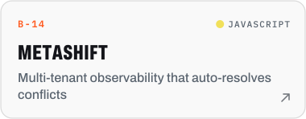</picture></a> <a href="https://github.com/GautamTalksDev/Work-Shift"><picture><source media="(prefers-color-scheme: dark) and (max-width: 767px)" srcset="assets/hangar-15-dark-n.svg"><source media="(max-width: 767px)" srcset="assets/hangar-15-light-n.svg"><source media="(prefers-color-scheme: dark)" srcset="assets/hangar-15-dark.svg">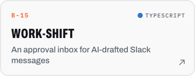</picture></a> <a href="https://github.com/GautamTalksDev/aeroguard-tech"><picture><source media="(prefers-color-scheme: dark) and (max-width: 767px)" srcset="assets/hangar-16-dark-n.svg"><source media="(max-width: 767px)" srcset="assets/hangar-16-light-n.svg"><source media="(prefers-color-scheme: dark)" srcset="assets/hangar-16-dark.svg">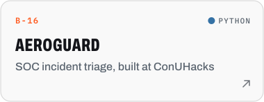</picture></a> <a href="https://github.com/GautamTalksDev/gautamtalks-site"><picture><source media="(prefers-color-scheme: dark) and (max-width: 767px)" srcset="assets/hangar-17-dark-n.svg"><source media="(max-width: 767px)" srcset="assets/hangar-17-light-n.svg"><source media="(prefers-color-scheme: dark)" srcset="assets/hangar-17-dark.svg">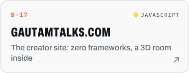</picture></a> <a href="https://github.com/GautamTalksDev/gautamtalksdev.github.io"><picture><source media="(prefers-color-scheme: dark) and (max-width: 767px)" srcset="assets/hangar-18-dark-n.svg"><source media="(max-width: 767px)" srcset="assets/hangar-18-light-n.svg"><source media="(prefers-color-scheme: dark)" srcset="assets/hangar-18-dark.svg">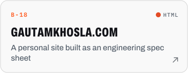</picture></a> <a href="https://github.com/GautamTalksDev/DSA-Programming-Assignments"><picture><source media="(prefers-color-scheme: dark) and (max-width: 767px)" srcset="assets/hangar-19-dark-n.svg"><source media="(max-width: 767px)" srcset="assets/hangar-19-light-n.svg"><source media="(prefers-color-scheme: dark)" srcset="assets/hangar-19-dark.svg">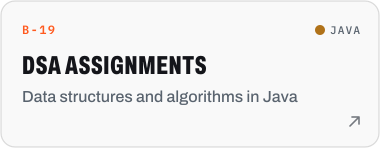</picture></a>

 

<picture><source media="(max-width: 767px)" srcset="assets/footer-n.svg?v=2026-11-08"></picture>

Every image here is an SVG in this repository, drawn from <a href="profile.toml">profile.toml</a> by <a href="flightlog/build.py">flightlog/build.py</a> and redrawn every night by a GitHub Action. Text is drawn as paths: no fonts, scripts or trackers.

